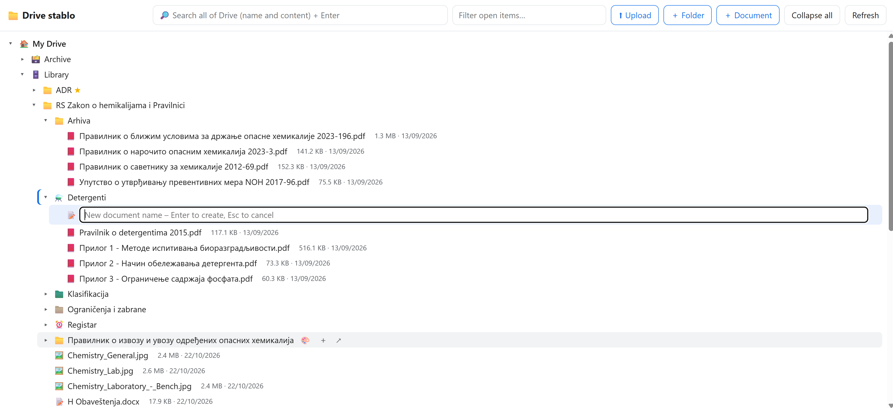
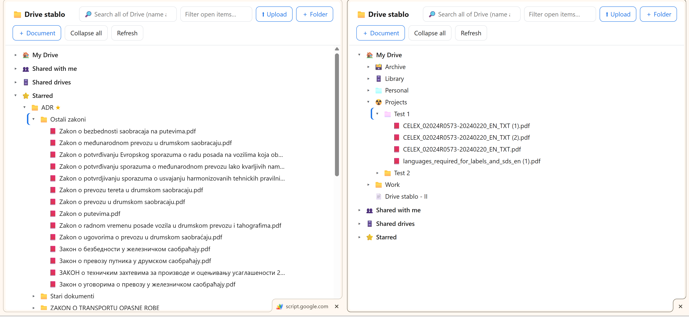
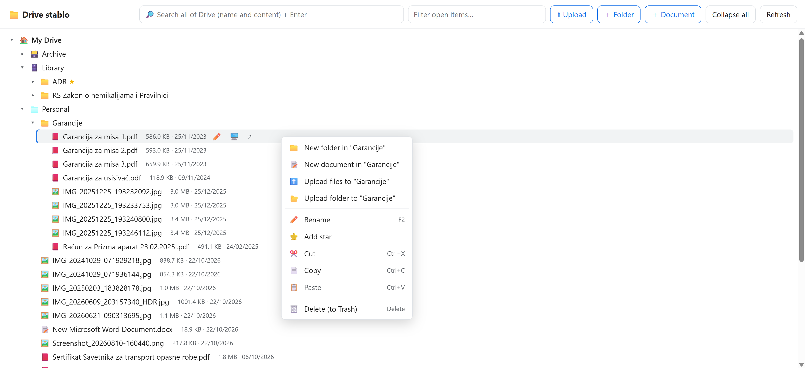
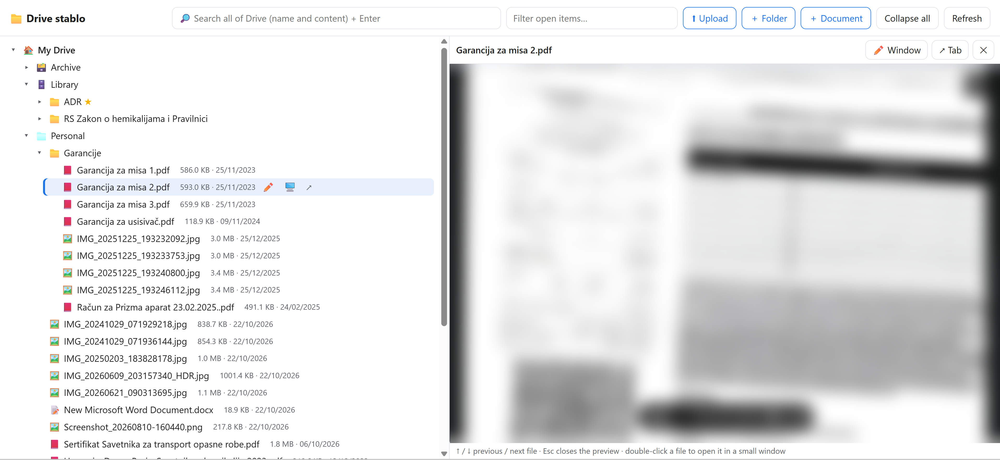

# Drive stablo 🌳📁

**Brz prikaz Google Drivea u obliku stabla, kao u Windows Exploreru.** Radi kao tvoja privatna Google Apps Script aplikacija.
Folderi se otvaraju strelicama u mestu, fajlovi se vide pored njih, a sve svakodnevne radnje sa fajlovima rade bez napuštanja stabla.

> 🇬🇧 English: [README.md](README.md)
> Interfejs aplikacije je na engleskom.

Još slika

## Mogućnosti

- **Stablo** za *Moj disk*, *Deljeno sa mnom*, *Deljene diskove* i *Sa zvezdicom*. Folderi se otvaraju odmah, jer se sledeći nivo učitava unapred.
- **Panel za pregled**: klik na fajl otvara pregled (PDF, Office, slike, Google Docs/Sheets/Slides), ↑/↓ prelistava, Esc zatvara. Dupli klik otvara fajl u malom prozoru za uređivanje.
- **Pretraga celog Drivea** po nazivu i sadržaju.
- **Radnje sa fajlovima**: novi folder, novi Google dokument, preimenovanje (F2), iseci/kopiraj/nalepi (Ctrl+X/C/V, i za cele foldere), brisanje u otpad sa „Poništi", premeštanje prevlačenjem.
- **Otpremanje** fajlova i celih foldera, dugmetom ili prevlačenjem sa računara, uz prikaz napretka.
- **Boje foldera** (iste kao u Google Driveu), **ikonice foldera** (bilo koji emodži), **zvezdice**.
- **Dva taba jedan pored drugog**: prevlačenje i kopiranje između njih, a oba se sama usklađuju.
- **Otvaranje u aplikaciji na računaru** (opciono, Windows): uz Google Drive for desktop, dugme 🖥️ otvara `.docx`/`.xlsx`/`.pdf`… sa diska G: u Wordu, Excelu… Izmene se same vraćaju na Drive.

## Instalacija (oko 3 minuta)

### Najlakše: kopija šablona

1. Otvori **[Drive stablo šablon](https://script.google.com/d/1p9MQE5Wfqr3r9fYu3wVVf_newyeX8kyHw5N4in6IDlQu43Es-_GchyLH/edit?usp=sharing)**, prijavljen na svoj Google nalog.
2. Levo klikni **Overview** (ⓘ), pa gore desno **Make a copy** (ikonica 📄). Sada imaš svoju privatnu kopiju.
3. **Deploy → New deployment →** ⚙️ **Web app**, uz podešavanja *Execute as*: **Me** i *Who has access*: **Only myself**.
4. **Deploy** → **Authorize access**. Na poruci *„Google hasn't verified this app"* klikni **Advanced → Go to Drive stablo (unsafe) → Allow**. To je normalno za skriptu koja je tvoja.
5. Otvori **Web app URL**. U Chromeu ⋮ → *Cast, save and share* → **Install page as app** daje ikonicu na taskbaru.

Tvoja kopija radi samo u tvom nalogu. Vlasnik šablona ne vidi ni kopiju ni tvoj Drive.

### Ručno: kopiraj i nalepi kod

1. Otvori [script.google.com](https://script.google.com) → **New project** i preimenuj ga u *Drive stablo*.
2. Sadržaj `Code.gs` zameni fajlom [`src/Code.gs`](src/Code.gs).
3. Klikni **+** pored *Files* → **HTML**, nazovi ga **`Index`** (bez `.html`) i nalepi [`src/Index.html`](src/Index.html).
4. Klikni **+** pored *Services* → **Drive API** → **Add**.
5. Nastavi od koraka 3 iznad.

**Nova verzija:** zameni fajlove → **Deploy → Manage deployments → ✏️ → New version → Deploy**. Link ostaje isti.

## Pomoćnik za otvaranje u Wordu (opciono, Windows)

> **Uslovi:** Windows, **[Google Drive for desktop](https://www.google.com/drive/download/) instaliran i prijavljen na isti Google nalog**, i ovaj pomoćnik. Bez njih sve ostalo u Drive stablu radi normalno; samo dugme 🖥️ ne radi ništa, a fajlove i dalje otvaraš u browseru preko ↗.

1. Instaliraj [Google Drive for desktop](https://www.google.com/drive/download/) (režim *Stream files*).
2. Preuzmi [`windows-helper/DriveStablo-instalacija.cmd`](windows-helper/DriveStablo-instalacija.cmd), pokreni ga duplim klikom i pritisni **Enter**. Administratorska prava nisu potrebna.
3. U stablu klikni 🖥️ pored fajla. Chrome prvi put pita *„Open Drive stablo?"*, a ti štikliraj **Always allow**.

Pomoćnik pravi mali program `otvori.exe` iz koda ugrađenog u `.cmd` fajl, koji možeš pročitati u Notepadu. Otvara **samo dokumente, slike, medije i arhive sa Google Drive diska**, nikad programe. Za uklanjanje pokreni isti fajl i upiši **U**.

## Saveti

- Ako pregled traži kolačiće, dozvoli kolačiće trećih strana za `script.google.com` (`chrome://settings/cookies`).
- Za više Google naloga koristi **poseban Chrome profil** za svaki nalog i posebnu kopiju skripte za svaki.
- Prenos između tabova radi samo kad su oba taba istog naloga.

## Podrška

Ako ti Drive stablo štedi vreme, možeš mi častiti kafu ☕

## Licenca

[MIT](LICENSE) © 2026 Dušan Bašić

*Projekat nije povezan sa kompanijom Google niti ga ona podržava. Google Drive je žig kompanije Google LLC.*
